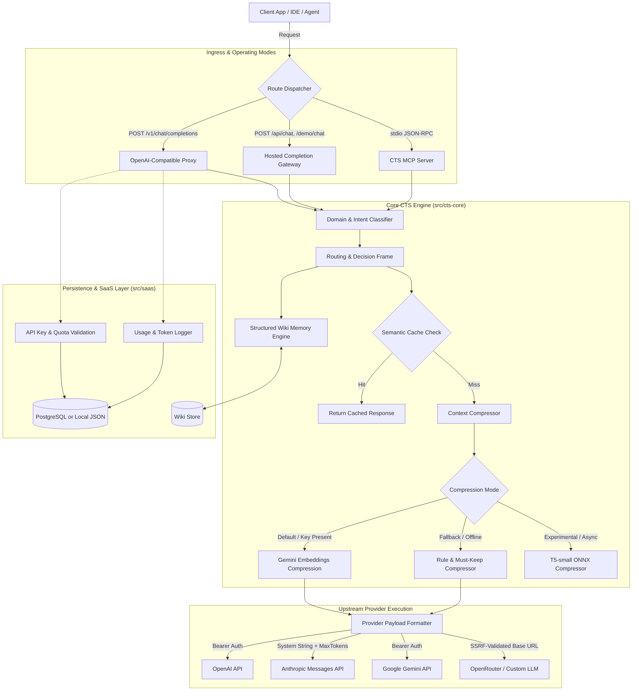

> Historical development-service report. This document predates the current npm SDK/CLI product. For current architecture, protection/memory defaults and verification, read [PRODUCT_CHANGES.md](PRODUCT_CHANGES.md), [README.md](README.md) and [compaction verification](docs/evidence/COMPACTION_VERIFICATION.md).

# EchoRegent (CTS) — Total Application Overview & Technical Reference

**System Name**: EchoRegent (Internal codebase identifier: `CTS` — Conversation Token System)
**Version**: `0.4.0`
**Runtime**: Node.js 20+ (ES Modules, TypeScript 5.6)
**Primary Function**: High-performance conversation intelligence and token optimization middleware positioned between client applications and Large Language Model (LLM) providers.

---

## 1. High-Level Architecture & Operating Modes

EchoRegent operates as an intelligent reverse proxy and conversation state manager. It intercepts multi-turn chat interactions, classifies intent and domain, minimizes prompt token bloat through deterministic or embedding-based compression, injects long-term structured memory, and relays requests to upstream LLM providers while logging verified cost and token telemetry.



EchoRegent supports **three distinct operating modes**:
1. **Proxy Mode (`/v1/chat/completions`)**: Drop-in OpenAI-compatible reverse proxy. Clients supply their own provider API keys (`x-llm-key`) and point `baseURL` to EchoRegent. EchoRegent classifies, compresses, forwards, injects `x-cts-*` telemetry headers, and logs real upstream token usage.
2. **Hosted Direct Mode (`/api/chat`, `/demo/chat`)**: EchoRegent functions as the completion provider directly using server-held credentials (`DEMO_LLM_API_KEY` or `GEMINI_API_KEY`), checking a local `all-MiniLM-L6-v2` semantic cache and ingesting long-term facts into user wikis.
3. **MCP Server Mode (`cts-mcp/`)**: Runs an out-of-band Model Context Protocol server over `stdio` transport for native integration with AI developer tools (Claude Desktop, Cursor, Codex).

---

## 2. Complete Route & Endpoint Directory

Every route implemented in [`src/server.ts`](file:///e:/echoregent/src/server.ts) is cataloged below:

### 2.1 System Health & Diagnostics

| Method | Path | Auth Required | Description |
|---|---|---|---|
| `GET` | `/health` | None | Returns server health status, version, uptime, and warm-up status of ML models (`classifier`, `t5`, `semanticCache`). |
| `GET` | `/ready` | None | Returns `{ ready: true }` when server is accepting connections. |

---

### 2.2 Web Pages & Static Frontends

| Method | Path | Auth Required | Description |
|---|---|---|---|
| `GET` | `/` | None | Serves production Vite landing page (`dist/index.html`) with interactive compression demo, ROI calculator, and waitlist form. |
| `GET` | `/admin-ui` | None (UI shell) | Serves the admin web dashboard shell (`src/admin-ui.ts`) to manage keys, inspect logs, and track waitlist requests. |
| `GET` | `/memory` | None (UI shell) | Serves the customer-facing memory management console (`src/memory-ui.ts`) and "What Was Compressed" audit log. |
| `GET` | `/docs` | None | Serves standalone API reference documentation (`src/docs.ts`). |
| `GET` | `/use-cases` | None | Serves industry use-case showcase (`src/usecases.ts`). |
| `GET` | `/assets/*` | None | Serves compiled static CSS and JavaScript assets from `dist/`. |

---

### 2.3 Public Demo Endpoints (IP Rate-Limited: 20 req/min)

| Method | Path | Payload / Headers | Response / Function |
|---|---|---|---|
| `POST` | `/demo/compress` | `{ message, history }` | Synchronous rule-based compression; returns compressed history, classified domain/intent, and estimated tokens saved. |
| `POST` | `/demo/compress-async` | `{ message, history }` | Asynchronous ML classification + T5 compression; returns token counts, dropped count, and kept reasons. |
| `POST` | `/demo/compress-embeddings` | Headers: `x-embedding-key`<br>Body: `{ message, history }` | Semantic-similarity compression using real Gemini embeddings (`text-embedding-004`). |
| `GET` | `/demo/waitlist-count` | None | Returns total count of waitlist key requests. |
| `POST` | `/demo/request-key` | `{ name, email, useCase }` | Enters a prospective user into the waitlist queue. |
| `POST` | `/demo/chat` | `{ message, history, sessionId }` | Live end-to-end hosted chat. Checks MiniLM semantic cache -> calls Gemini/OpenRouter -> triggers fire-and-forget wiki ingestion after turn 4. |

---

### 2.4 OpenAI-Compatible Reverse Proxy

| Method | Path | Headers | Description |
|---|---|---|---|
| `POST` | `/v1/chat/completions` | `Authorization: Bearer <cts-key>`<br>`x-llm-key: <provider-key>`<br>`x-llm-provider: openai \| anthropic \| gemini`<br>`x-llm-model: <model-name>`<br>`x-embedding-key: <gemini-key>` (optional)<br>`x-llm-base-url: <url>` (optional) | Core reverse proxy. Validates message shape, classifies intent, compresses context, reshapes request to target provider format, streams or delivers JSON, injects `x-cts-*` response headers, and records real billed token usage in PostgreSQL. |

#### Injected Response Headers on `/v1/chat/completions`:
- `x-cts-tokens-saved`: Pre-call token savings estimate (integer).
- `x-cts-domain`: Classified domain (`coding`, `customer_support`, `sales`, `legal`, `medical`, etc.).
- `x-cts-intent`: Classified intent (`debugging`, `escalation`, `task_execution`, etc.).
- `x-cts-compression-pct`: Percentage of original tokens saved (0–100).
- `x-cts-risk`: Comma-separated risk signals (`medical_caution`, `legal_caution`, `crisis`, `financial_caution`, `unsafe_request`).
- `x-cts-compression-mode`: Mode executed (`embeddings` or `regex`).
- `x-cts-actual-usage`: Upstream provider's ground-truth billed usage JSON (`prompt_tokens`, `completion_tokens`, `total_tokens`).

---

### 2.5 Authenticated Customer API Endpoints

| Method | Path | Auth | Description |
|---|---|---|---|
| `POST` | `/compress` | Bearer CTS Key | Authenticated context compression endpoint for backend pipelines. |
| `POST` | `/api/classify` | Bearer CTS Key | Standalone text classification (returns domain, intent, conversation state, confidence). |
| `POST` | `/api/chat` | Bearer CTS Key | Hosted chat execution with automated user wiki retrieval and memory extraction. |
| `GET` | `/api/wiki` | Bearer CTS Key | Retrieves structured memory (`userWiki` and `llmWiki`). Supports `x-end-user-id` header for tenant isolation. |
| `DELETE` | `/api/wiki` | Bearer CTS Key | Deletes or resets the structured wiki memory for the calling key/user. |
| `POST` | `/api/wiki/ingest-chat` | Bearer CTS Key | Manually ingests a multi-turn transcript into the user's structured wiki memory. |
| `POST` | `/api/llm-wiki/ingest-source` | Bearer CTS Key | Ingests arbitrary raw text into an LLM-managed knowledge wiki with entity extraction. |
| `POST` | `/api/llm-wiki/lint` | Bearer CTS Key | Lints wiki memory graph for stale facts, contradictions, and circular references. |
| `POST` | `/api/llm` | Bearer CTS Key | Direct gateway to invoke configured LLM providers via EchoRegent. |
| `GET` | `/api/usage` | Bearer CTS Key | Returns usage stats for the calling key (`totalCalls`, `totalTokensSaved`, `quotaUsed`, `quotaLimit`). |
| `GET` | `/api/usage/calls` | Bearer CTS Key | Returns recent call logs (metadata only: endpoint, tokens saved, provider, model, compression %). |

---

### 2.6 Admin Fleet Management Endpoints (`X-Admin-Secret` Header)

| Method | Path | Description |
|---|---|---|
| `POST` | `/admin/keys` | Generates a new CTS API key (`cts_...`), stores SHA-256 hash, and optionally emails the key via Resend. |
| `GET` | `/admin/dashboard` | Fleet-wide overview of all issued API keys, active statuses, quota limits, and total tokens saved. |
| `GET` | `/admin/keys/:id/usage` | Detailed historical call logs for a specific key. |
| `DELETE` | `/admin/keys/:id` | Revokes an API key. |
| `PATCH` | `/admin/keys/:id` | Modifies key configuration (updates quota limit or toggles active status). |
| `GET` | `/admin/key-requests` | Retrieves waitlist submissions. |
| `POST` | `/admin/key-requests/:id/fulfill` | Approves a waitlist applicant, automatically creates their key, and emails credentials. |
| `GET` | `/admin/model-health` | Diagnostic status of ONNX models and local caches. |
| `GET` | `/admin/cache-stats` | Semantic cache statistics: total queries, cache hits, hit rate, and output tokens saved. |

---

### 2.7 Internal Development & Testing Endpoints (Disabled in Production)

| Method | Path | Description |
|---|---|---|
| `POST` | `/test/wiki` | Test harness for verifying wiki serialization and entity persistence (returns 403 in `production`). |
| `POST` | `/test/cache` | Test harness for exercising MiniLM semantic cache embeddings (returns 403 in `production`). |

---

## 3. Core Engine Subsystems (`src/cts-core/`)

### 3.1 Taxonomy & Type System ([`types.ts`](file:///e:/echoregent/src/cts-core/types.ts))
The foundational data structure passed through all middleware pipelines is the `RoutingFrame`:

```typescript
interface RoutingFrame {
  intent: IntentType
  state: ConversationState
  domain: DomainType
  risk: RiskSignal[]
  signals: ExtractedSignals
  confidence: { intent: number; state: number; domain: number; risk: number }
}
```

- **`DomainType`**: `general` \| `coding` \| `customer_support` \| `sales` \| `legal` \| `medical` \| `education` \| `commerce` (plus open string extension for custom plugins).
- **`IntentType`**: `information_seeking` \| `task_execution` \| `decision_support` \| `comparison` \| `summarization` \| `generation` \| `debugging` \| `escalation` \| `objection_handling` \| `confirmation_seeking` \| `exploration` \| `correction`.
- **`ConversationState`**: `opening` \| `deepening` \| `pivoting` \| `returning` \| `escalating` \| `resolving` \| `closing`.
- **`RiskSignal`**: `medical_caution` \| `legal_caution` \| `financial_caution` \| `protected_context` \| `unsafe_request` \| `crisis`.

---

### 3.2 Intent & Domain Classifier ([`classifier.ts`](file:///e:/echoregent/src/cts-core/classifier.ts), [`ml-classifier.ts`](file:///e:/echoregent/src/cts-core/ml-classifier.ts))
- **Synchronous Classifier**: Rule-based regex scoring engine. Evaluates keyword densities, syntax cues (code fences, HTTP verbs, error traces), and discourse markers. Executes in **< 0.05ms**.
- **Asynchronous Classifier**: Uses `@xenova/transformers` with local fine-tuned `distilbert-base-uncased` ONNX weights (`ml/cts_classifier`). If local weights are missing, gracefully defaults to the synchronous rule classifier.

---

### 3.3 Context Compressor ([`compressor.ts`](file:///e:/echoregent/src/cts-core/compressor.ts), [`embeddings.ts`](file:///e:/echoregent/src/cts-core/embeddings.ts), [`ml-t5.ts`](file:///e:/echoregent/src/cts-core/ml-t5.ts))
The compressor reduces token length while preserving semantic continuity across turns:

1. **Embedding-Based Compression (`compressHistoryWithEmbeddings`) — Live Default**:
   - Generates vector embeddings for conversation turns using Gemini `text-embedding-004`.
   - Computes cosine similarity between historical messages and the active user prompt.
   - Retains messages with cosine similarity above dynamic threshold.
   - Enforces an architectural **minimum-retention floor** (keeps at least 15% of messages or 4 turns) to avoid compression collapse.

2. **Rule-Based Compression (`compressHistory`) — Fallback**:
   - Scores message relevance based on domain entity density and recency.
   - **Must-Keep Pass**: Guarantees code blocks, stack traces, tracking numbers, and critical constraints are never stripped.
   - Injects a structured `CTS summary:` message representing the summarized older history.

3. **T5 ONNX Compressor (`compressHistoryAsync`) — Blocked / Unused**:
   - T5 encoder-decoder pipeline intended for abstractive summarization. Currently bypassed on the proxy path because the export lacks proper SentencePiece word boundaries.

---

### 3.4 Semantic Cache ([`semantic-cache.ts`](file:///e:/echoregent/src/cts-core/semantic-cache.ts))
- Implements output token caching for hosted chat endpoints.
- Uses `sentence-transformers/all-MiniLM-L6-v2` ONNX pipeline.
- Calculates cosine similarity against prior queries within the same session/domain.
- If similarity exceeds `0.92`, the server returns the cached reply immediately with `cacheHit: true`, avoiding upstream inference latency and cost entirely.

---

### 3.5 Tokenizer & Accounting ([`tokenizer.ts`](file:///e:/echoregent/src/cts-core/tokenizer.ts))
- Replaces legacy character heuristics (`chars / 4`) with exact BPE tokenization via `gpt-tokenizer` (`cl100k_base` encoding).
- Accurately counts prompt tokens, chat markup overhead (`<|im_start|>`), and system prompt tokens.
- Explicitly labels all pre-call figures as `estimated` while recording verified upstream usage in `x-cts-actual-usage`.

---

### 3.6 Structured Long-Term Memory ([`wiki.ts`](file:///e:/echoregent/src/cts-core/wiki.ts), [`llmWiki.ts`](file:///e:/echoregent/src/cts-core/llmWiki.ts))
- Implements two tiers of persistent memory:
  - **User Wiki (`userWiki`)**: Lightweight profile facts (names, preferences, tech stacks, hardware).
  - **Knowledge Wiki (`llmWiki`)**: Graph-based associative topic pages with cross-references, entity tags, and contradiction checks.
- Generates compact context strings (`wikiToContextString`) for injection into system prompts.

---

## 4. SaaS, Security & Data Persistence (`src/saas/`)

### 4.1 Authentication & Multi-Tenancy ([`auth.ts`](file:///e:/echoregent/src/saas/auth.ts))
- **API Key Format**: High-entropy strings prefixed with `cts_` (e.g. `cts_c2d4aa...`).
- **Security Storage**: Keys are hashed with **SHA-256** prior to database storage. Plaintext keys are never stored or logged.
- **End-User Scoping**: Supports the `x-end-user-id` header. Scopes memory to `key_id:end_user_id` so that multiple end users of a customer do not bleed personal facts into each other.
- **Rate Limiting**: Enforces a per-key sliding rate limit (default 60 req/min) and IP rate limits for demo endpoints (20 req/min).

---

### 4.2 Database Layer & Auto-Migrations ([`database.ts`](file:///e:/echoregent/src/saas/database.ts), [`db.ts`](file:///e:/echoregent/src/saas/db.ts))
- **PostgreSQL Pool**: Managed via `pg.Pool` using `DATABASE_URL`. Sized conservatively (`max: 2` connections per instance) to safely accommodate micro-tier databases (e.g. Google Cloud SQL `db-f1-micro` or Railway Postgres).
- **Auto-Boot Migration**: `initDb()` executes automatically on startup using non-destructive DDL (`CREATE TABLE IF NOT EXISTS`, `ALTER TABLE ADD COLUMN IF NOT EXISTS`).

#### Database Schema:
```sql
-- API Keys and quotas
CREATE TABLE api_keys (
  id           TEXT PRIMARY KEY,
  key_hash     TEXT UNIQUE NOT NULL,
  name         TEXT NOT NULL DEFAULT '',
  owner_email  TEXT NOT NULL DEFAULT '',
  created_at   TIMESTAMPTZ NOT NULL DEFAULT NOW(),
  last_used_at TIMESTAMPTZ,
  active       BOOLEAN NOT NULL DEFAULT TRUE,
  quota_limit  INTEGER NOT NULL DEFAULT 10000,
  quota_used   INTEGER NOT NULL DEFAULT 0
);

-- Granular request and telemetry logging
CREATE TABLE usage_log (
  id                       SERIAL PRIMARY KEY,
  key_id                   TEXT NOT NULL,
  endpoint                 TEXT NOT NULL,
  called_at                TIMESTAMPTZ NOT NULL DEFAULT NOW(),
  tokens_saved             INTEGER NOT NULL DEFAULT 0,
  domain                   TEXT,
  provider                 TEXT,
  model                    TEXT,
  actual_prompt_tokens     INTEGER,
  actual_completion_tokens INTEGER,
  actual_total_tokens      INTEGER,
  compression_mode         TEXT,
  messages_original        INTEGER,
  messages_kept            INTEGER,
  compression_pct          INTEGER
);

-- Structured customer and end-user memory
CREATE TABLE wiki_store (
  key_id      TEXT PRIMARY KEY,
  user_wiki   JSONB,
  llm_wiki    JSONB,
  updated_at  TIMESTAMPTZ NOT NULL DEFAULT NOW()
);

-- Self-service waitlist queue
CREATE TABLE key_requests (
  id           SERIAL PRIMARY KEY,
  name         TEXT,
  email        TEXT,
  use_case     TEXT,
  requested_at TIMESTAMPTZ NOT NULL DEFAULT NOW(),
  fulfilled_at TIMESTAMPTZ
);
```

- **Local Development Fallback**: If `DATABASE_URL` is omitted, the application seamlessly falls back to local JSON storage under `data/` (`keys.json`, `usage.json`, `wikis.json`, `key-requests.json`).

---

### 4.3 Network Security & SSRF Protection
- The reverse proxy validates custom upstream base URLs passed via `x-llm-base-url`:
  - Enforces `https://` protocol.
  - Performs live DNS resolution and verifies that the destination does **not** resolve to private, loopback, or link-local addresses (e.g. `127.0.0.1`, `10.x.x.x`, `192.168.x.x`, or cloud metadata `169.254.169.254`).
- Drops unsupported message shapes cleanly with a **400 Bad Request** (rejects tool calls, null content, and multimodal arrays) to prevent downstream server crashes.

---

## 5. Model Context Protocol (MCP) Server (`cts-mcp/`)

The `cts-mcp` package provides an independent tool server compliant with the Anthropic Model Context Protocol specification:

- **Transport**: `StdioServerTransport` (standard input/output pipes).
- **Tools Exposed**:
  1. `cts_compress_history`: Compresses massive terminal logs or chat transcripts using `smartScrape` heuristic and `Xenova/t5-small`.
  2. `cts_classify_intent`: Detects domain and user intent using `Xenova/distilbert-base-uncased-finetuned-sst-2-english`.
  3. `cts_memory_remember`: Stores facts, decisions, or summaries into local structured wiki storage.
  4. `cts_memory_recall`: Retrieves relevant memory context for an active user query.

---

## 6. Deployment & Infrastructure Footprint

| Component | Specification | Details |
|---|---|---|
| **Containerization** | [`Dockerfile`](file:///e:/echoregent/Dockerfile) | Base: `node:20-slim`. Installs dependencies (`npm ci`), builds frontend (`npm run build`), exposes port `8787`, starts via `npx tsx src/server.ts`. |
| **Active Deployment Target** | **Railway** | Configured via [`railway.toml`](file:///e:/echoregent/railway.toml) and [`nixpacks.toml`](file:///e:/echoregent/nixpacks.toml). Production URL: `https://cts-v4-production.up.railway.app`. |
| **GCP Compatibility** | Cloud Run & Cloud SQL | Compatible with Cloud Run container execution. Database connection pool configured to honor Cloud SQL micro-instance limits. |
| **Continuous Integration** | [`.github/workflows/ci.yml`](file:///e:/echoregent/.github/workflows/ci.yml) | GitHub Actions workflow executing `npm ci`, `npm run build`, and `npm test` across all branches. |
| **Model Distribution** | Decoupled Weights | ONNX models (`ml/`) are excluded from Git repository and container images. Application boots cleanly using resilient rule-based fallbacks. |

---

## 7. File System & Module Map

```
echoregent/
├── .github/workflows/
│   └── ci.yml                     # GitHub Actions CI workflow
├── audit/
│   ├── bench/                     # Benchmarks (breakeven.ts, manual_prompt_tests.ts, paired-eval.ts)
│   ├── notes/                     # Eval scripts & run outputs (comprehensive_eval.ts, timing_classify.ts)
│   └── tests/                     # Vitest audit suite (integration, protected-zones, prompt-caching)
├── cts-mcp/                       # Model Context Protocol stdio server
│   ├── package.json
│   └── src/                       # MCP tools (smartScrape, memory, classification)
├── dist/                          # Compiled production frontend assets (HTML, CSS, JS)
├── docs/                          # Architecture documentation & diagrams
├── src/
│   ├── admin-ui.ts                # Server-rendered HTML dashboard for /admin-ui
│   ├── memory-ui.ts               # Server-rendered HTML UI for /memory
│   ├── docs.ts                    # Server-rendered HTML UI for /docs
│   ├── usecases.ts                # Server-rendered HTML UI for /use-cases
│   ├── main.ts                    # Client-side JavaScript for landing page demo
│   ├── styles.css                 # Vanilla CSS design system
│   ├── server.ts                  # Central HTTP server and routing engine
│   ├── providerServer.ts          # Provider client implementations (OpenAI, Anthropic, Gemini, OpenRouter)
│   ├── cts-core/                  # Core token optimization and intelligence library
│   │   ├── classifier.ts          # Fast rule-based domain & intent classification
│   │   ├── compressor.ts          # Context compressor (regex and embeddings)
│   │   ├── embeddings.ts          # Gemini embedding API integration
│   │   ├── ml-classifier.ts       # DistilBERT ONNX classifier
│   │   ├── ml-t5.ts               # T5 ONNX summarizer
│   │   ├── router.ts              # Pipeline coordinator & system prompt generator
│   │   ├── semantic-cache.ts      # MiniLM ONNX vector cache
│   │   ├── signals.ts             # Linguistic signal extraction
│   │   ├── tokenizer.ts           # BPE token counting via gpt-tokenizer
│   │   ├── types.ts               # Shared TypeScript schemas & interfaces
│   │   └── wiki.ts, llmWiki.ts    # Structured long-term memory engine
│   ├── evals/                     # Quality, token reduction, and plugin evaluation harnesses
│   └── saas/                      # Multi-tenant authentication, quota, and database layer
│       ├── auth.ts                # API key verification & rate limiting
│       ├── database.ts            # PostgreSQL pool and auto-migration
│       └── db.ts                  # Data access layer (PostgreSQL + JSON fallback)
├── Dockerfile                     # Container deployment definition
├── railway.toml                   # Railway platform deployment config
├── nixpacks.toml                  # Nixpacks build plan
├── package.json                   # Project manifest & dependency tree
├── tsconfig.json                  # TypeScript compiler settings
├── AUDIT.md                       # Comprehensive 2026 technical & commercial audit
├── ONBOARDING.md                  # New-hire engineering roadmap & system walkthrough
├── PRODUCTION_READINESS.md        # Pre-pilot checklist & deployment gap log
├── TEST_RESULTS.md                # Full test run logs & manual evaluation results
└── README.md                      # Product overview & quickstart guide
```
