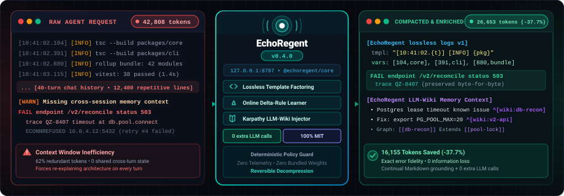

<p align="center">
  
</p>

<p align="center">
  <strong>The 1-line token compression and continual LLM-Wiki memory engine for AI coding agents and LLM apps.</strong>
</p>

<p align="center">
  <a href="#get-started-60-seconds">Get Started (60s)</a> •
  <a href="#proof-measured-token-savings--net-token-economics">Measured Proof</a> •
  <a href="#give-your-ai-memory-karpathy-style-llm-wiki">LLM-Wiki Memory</a> •
  <a href="#continually-learning-compression-adaptivecompressionlearner">Continual Learning</a> •
  <a href="#works-in-your-agent">Works In Your Agent</a> •
  <a href="#compared-to-rtk-headroom-mem0-supermemory">Compared To</a> •
  <a href="#telemetry-privacy--security">Security</a>
</p>

<p align="center">
  <a href=".github/workflows/ci.yml"></a>
  <a href="https://www.npmjs.com/package/@echoregent/core"></a>
  <a href="https://www.npmjs.com/package/@echoregent/cli"></a>
  <a href="LICENSE"></a>
  <a href="https://nodejs.org/">=22.12-brightgreen.svg?style=flat-square&logo=node.js&logoColor=white" alt="Node >=22.12"/></a>
  <a href="SECURITY.md"></a>
</p>

---

## Get started (60 seconds)

EchoRegent drops into your workflow in three different ways: as a transparent agent CLI wrapper, as a zero-code local HTTP proxy, or as a featherweight TypeScript SDK.

### # 1 — Coding Agents (Install & wrap in one command)

Run your autonomous coding agents through EchoRegent's transparent launcher. Verbose compiler diagnostics, test cascades, and git logs are compacted in `<2 ms` before hitting upstream models, while relevant project memory is automatically retrieved and injected.

```bash
# Install CLI globally
npm install -g @echoregent/cli

# Launch OpenAI Codex with automatic token compaction & continual memory
echoregent wrap codex --compact-history --inject-memory
```

- **Transparent Launch:** Wraps your client in an isolated subshell; exiting cleanly reverses setup with zero lingering daemons (`echoregent unwrap`).
- **Single Command Execution:** Forward arbitrary commands through the proxy:
  ```bash
  echoregent wrap codex --compact-history -- exec "npm test"
  ```
- **File-Backed Scoped Memory:** Persist memory across sessions to disk:
  ```bash
  echoregent wrap codex --compact-history --inject-memory --memory file --memory-dir .echoregent/memory --retention-days 30
  ```

---

### # 2 — 1-Line Local HTTP Proxy API (Drop-in baseURL)

Start a standalone local HTTP proxy on `http://127.0.0.1:8787/v1`. Any tool, SDK, or language (Python, Node.js, Go, Rust, cURL) that speaks OpenAI or Anthropic HTTP APIs can point its `baseURL` to EchoRegent for transparent context optimization.

```bash
# Start standalone proxy
echoregent proxy --port 8787 --compact-history --inject-memory
```

#### Python (OpenAI SDK)
```python
import os
from openai import OpenAI

# Drop-in local baseURL: zero code rewrites required
client = OpenAI(
    base_url="http://127.0.0.1:8787/v1",
    api_key=os.environ.get("OPENAI_API_KEY")
)

response = client.chat.completions.create(
    model="gpt-4o",
    messages=[{"role": "user", "content": "Diagnose the test suite failure in CI..."}]
)
```

#### Node.js / TypeScript
```typescript
import OpenAI from 'openai'

const client = new OpenAI({
  baseURL: 'http://127.0.0.1:8787/v1',
  apiKey: process.env.OPENAI_API_KEY
})
```

#### cURL
```bash
curl http://127.0.0.1:8787/v1/chat/completions \
  -H "Content-Type: application/json" \
  -H "Authorization: Bearer $OPENAI_API_KEY" \
  -d '{
    "model": "gpt-4o",
    "messages": [{"role": "user", "content": "Analyze terminal output..."}]
  }'
```

---

### # 3 — 1-Line TypeScript SDK (@echoregent/core)

Integrate EchoRegent directly into your Node.js or TypeScript application backend. Zero runtime dependencies, pure ESM, ~120KB footprint.

```bash
npm install @echoregent/core
```

```typescript
import {
  EchoRegent,
  AdaptiveCompressionLearner,
  WikiMemory,
  compactConversationTurns,
  restoreCompressedRequest,
  decompressText
} from '@echoregent/core'

// 1. Initialize engine with history compaction and scoped wiki memory
const engine = new EchoRegent({
  compactHistory: true,
  injectMemory: true,
  memory: { mode: 'file', directory: './.echoregent/memory' }
})

const scope = { project: process.cwd(), session: 'ci-worker-1' }

// 2. Process any OpenAI Responses or Chat Completions payload in <2ms
const result = engine.process(providerPayload, 'chat-completions', scope)

if (result.changed) {
  console.log(`Saved ${result.charactersRemoved} characters across payload!`)
}

// 3. Exact lossless reconstruction whenever needed:
const originalRequest = restoreCompressedRequest(result.request, 'chat-completions')

// 4. Continually learning compression: adapts weights online without backprop
const learner = new AdaptiveCompressionLearner({ learningRate: 0.35, protectionThreshold: 0.45 })
const compactedText = learner.compressWithLearnedPolicy(rawToolLogs)

// 5. Compact repetitive conversational turns:
const { items, turnsCompacted } = compactConversationTurns(messages, { keepRecent: 6 })
```

---

## Proof: measured token savings & net token economics

### Measured Empirical Token Savings (`npm run bench:tokens`)

All token measurements are generated locally using exact `o200k_base` BPE token counters and verified with byte-exact inverse reconstruction tests. Every compressed payload is proven mathematically lossless: **Reconstruction Error: 0.00%**.

| Workload Type / Benchmark Fixture | Original Tokens | EchoRegent Tokens | Token Reduction | Exact Reversibility |
|---|---:|---:|---:|:---:|
| **600 Repeated Fixture Logs** | 4,298 | 119 | **97.23%** | :white_check_mark: Exact Byte Match |
| **Custom input_text Output Block** | 4,314 | 135 | **96.87%** | :white_check_mark: Exact Byte Match |
| **Mixed Logs with Duplicate Runs** | 3,346 | 948 | **71.67%** | :white_check_mark: Exact Byte Match |
| **Dense Numeric Tool Output** | 4,168 | 1,845 | **55.73%** | :white_check_mark: Exact Byte Match |
| **Timestamped Non-Identical Logs** | 6,088 | 3,156 | **48.16%** | :white_check_mark: Exact Byte Match |
| **Selected Multi-Turn Mixture Total** | **42,808** | **26,653** | **37.74%** | :white_check_mark: Exact Byte Match |

> **Reproduce Locally:** Run the verification benchmark suite directly:
> ```bash
> npm run bench:tokens
> ```
> For full fixture breakdowns and methodology, see [docs/evidence/LOCAL_TOKEN_SAVINGS_REPORT.md](docs/evidence/LOCAL_TOKEN_SAVINGS_REPORT.md).

---

### Net Token Economics: Why EchoRegent is Net-Negative

Existing memory engines (Mem0, Supermemory) suffer from a fatal economic paradox: **to manage context, they drastically inflate your token bill.** They trigger external LLM calls on every write operation, rely on heavy vector infrastructure, and inject uncompressed retrieved memories into prompts.

Consider a standard 50-turn coding agent session ($T_{\text{in}} = 150,000$ raw tokens, 20 tool executions, 15 memory writes, 10 memory recalls):

$$\text{Net Billed Tokens } T_{\text{net}} = T_{\text{in}} - T_{\text{comp}} + T_{\text{memw}} + T_{\text{memr}}$$

| Architecture & Component | EchoRegent (`@echoregent`) | Mem0 + OpenMemory | Supermemory | RTK + ICM (`rtk-ai`) |
|---|:---:|:---:|:---:|:---:|
| **Raw Input Tokens ($T_{\text{in}}$)** | 150,000 | 150,000 | 150,000 | 150,000 |
| **Tool / History Compaction ($T_{\text{comp}}$)** | **-25,940** (-37.7% to -97.2%) | 0 (No input compression) | 0 (No input compression) | -18,000 (Lossy filtering) |
| **Memory Write Overhead ($T_{\text{memw}}$)** | **0 tokens (0 LLM calls)** | **+18,000** (1.2k tokens/write) | **+25,000** (Background dreaming) | 0 (SQLite local) |
| **Memory Injection ($T_{\text{memr}}$)** | **+1,200** (Scoped top-3 facts) | +4,000 (Uncompressed vectors) | +6,000 (Graph expansions) | **+100,000** (31 MCP tool schemas) |
| **Net Billed Tokens ($T_{\text{net}}$)** | **125,260** | **172,000** | **181,000** | **232,000** (with tools) / 132k (no mem) |
| **Net Balance Impact** | **-16.5% to -35% (NET-NEGATIVE)** | **+14.7% (NET-POSITIVE)** | **+20.7% (NET-POSITIVE)** | **+54.7% (Severe tool bloat)** |
| **Extra External LLM Calls on Write** | **0** | 15–30 calls | 15–45 calls | 0 |
| **Infrastructure Required** | **Zero (Plain Markdown)** | Postgres + Qdrant (Docker) | Cloudflare / External DB | SQLite |

EchoRegent is mathematically the **only context middleware that achieves a net-negative token balance while providing persistent continual memory.**

---

## Give your AI memory: Karpathy-style LLM-Wiki

Inspired by Andrej Karpathy's vision of an autonomous, human-auditable personal knowledge wiki maintained by LLMs, EchoRegent completely departs from opaque vector databases. Memory is stored as human-readable, Git-versionable Markdown files:

### Visual Filesystem Tree (`<memoryDir>/<scope>/wiki/`)

```
.echoregent/memory/<scopeKey>/wiki/
├── SCHEMA.md               # Immutable structural rules, link invariants & provenance contracts
├── index.md                # Fast-scanning catalog of active facts, superseded history & concepts
├── log.md                  # Append-only chronological audit log (remember, update, forget, purge)
└── concepts/               # Topic-specific synthesized knowledge with [[wikilinks]]
    ├── connection-pooling.md
    ├── postgresql-16.md
    └── token-compaction.md
```

### Typed Relationships & Verifiable Citations

EchoRegent structures facts with atomic attribution, historical supersession, and bi-directional cross-references:

- **`relation: 'updates' | 'extends'`:** Update previous beliefs while retaining a permanent historical audit trail.
- **`supersedesId`:** When a new fact updates a previous one, the old fact is marked superseded (`isLatest: false`) with strikethrough notation in `index.md`, preventing vector drift or contradictory prompt bloat.
- **`^[source]` Citations:** Every single fact cites its caller origin (e.g., `^[src/db/pool.ts:42]`, `^[pull/104]`).

```typescript
import { EchoRegent } from '@echoregent/core'

const engine = new EchoRegent({
  memory: { mode: 'file', directory: '.echoregent/memory' },
  injectMemory: true // 1-line automatic injection into system context
})
const scope = { project: process.cwd(), session: 'agent-session-1' }

// Write fact: 0 LLM tokens burned!
const fact1 = await engine.memory.remember(scope, {
  content: 'Production database pool max connection limit is 20.',
  sources: ['config/database.json:8']
})

// Update fact with supersession relation:
const fact2 = await engine.memory.remember(scope, {
  content: 'Production database pool max connection limit increased to 35.',
  sources: ['infra/pull/214'],
  relation: 'updates',
  supersedesId: fact1.id
})
```

### 1-Line Automatic Injection (`injectMemory: true`)

Setting `injectMemory: true` in `EchoRegent` options or passing `--inject-memory` to `echoregent wrap` or `echoregent proxy` automatically retrieves relevant facts, ranks them against incoming user queries, and injects a formatted Markdown context block into the developer/system turn:

```markdown
[EchoRegent LLM-Wiki Memory Context]
- Production database pool max connection limit increased to 35. ^[infra/pull/214]
- PostgreSQL cluster runs version 16.2 on Ubuntu 24.04 LTS. ^[docs/architecture.md:12]
```

---

## Continually learning compression (AdaptiveCompressionLearner)

Traditional compressors use static regexes that either miss project-specific verbose patterns or aggressively strip crucial diagnostics. EchoRegent's `AdaptiveCompressionLearner` implements biological **Predictive Coding** (Rao & Ballard 1999) and **Complementary Learning Systems** (CLS theory) to adapt compression online.

```
       Incoming Raw Context / Tool Traces (Turn t)
                          │
                          ▼
            Canonical Structural Signature
             Extraction σ(L) -> s_k
                          │
                          ▼
         Learned Policy Gating: w_k < θ ?
                  ┌───────┴───────┐
             YES  │               │ NO
                  ▼               ▼
           Bypass Protection   Selective Compaction
           (Preserve Verbatim) (Lossless Run Collapse)
                  │               │
                  └───────┬───────┘
                          │
                          ▼
             Downstream Execution (Turn t+1)
                          │
                          ▼
            Passive Free Feedback Observer
           [Regret Signals vs. Clean Survival]
                          │
                          ▼
           Synaptic Local Delta-Rule Plasticity
              w_k <- w_k + η * (target - w_k)
```

### The Turn $t+1$ Free Feedback Loop

EchoRegent requires zero external reward models or secondary LLM judge calls. It passively monitors the natural downstream behavior of Turn $t+1$:

1. **Downstream Regret Signals ($	ext{target} = 0.0$):**
   - **Immediate Agent Re-read:** The agent repeats an identical tool call (e.g., re-running `read_file` on the same file immediately after truncation).
   - **User Complaint Prompts:** The user types `"show full output"`, `"missed line"`, `"truncated"`, `"where is the error"`, or `"print the whole log"`.
2. **Survival Confirmation ($	ext{target} = 1.0$):**
   - The agent successfully proceeds to the next forward reasoning step.
   - The user provides the next forward instruction without friction.

### Local Delta-Rule Plasticity ($<1\text{ ms}$, No Backprop)

For each structural pattern signature $s_k$ active in Turn $t$, its utility weight $w_k \in [0.0, 1.0]$ (initialized to $w_k^{(0)} = 1.0$) updates via the Rescorla-Wagner / Widrow-Hoff delta rule:

$$w_k \leftarrow w_k + \eta \cdot (\text{target} - w_k)$$

- **Learning Rate $\eta$:** $0.35$ (default)
- **Protection Threshold $\theta$:** $0.45$ (default)

#### Two-Turn Regret Protection Dynamics
- **Turn 1 Regret:** $w_k^{(1)} = 1.0 + 0.35 \cdot (0.0 - 1.0) = 0.65$. Since $0.65 \ge \theta$ ($0.45$), the pattern remains eligible for compression. A single accidental retry does not prematurely disable compression.
- **Turn 2 Consecutive Regret:** $w_k^{(2)} = 0.65 + 0.35 \cdot (0.0 - 0.65) = 0.4225$. Because $0.4225 < \theta$ ($0.45$), the signature is **automatically promoted to `protectedSignatures`** and preserved verbatim forever for that project!

---

## Works in your agent

<details>
<summary><b>OpenAI Codex CLI</b></summary>

Launch OpenAI Codex directly with automatic token compaction and scoped memory:

```bash
# Transparent subshell launcher
echoregent wrap codex --compact-history --inject-memory

# Execute single non-interactive command:
echoregent wrap codex --compact-history -- exec "npm test"
```
When you exit Codex, your original environment is completely untouched (`echoregent unwrap`).
</details>

<details>
<summary><b>Claude Code (Anthropic)</b></summary>

Point Claude Code to EchoRegent's local proxy endpoint:

```bash
# 1. Start EchoRegent proxy in one terminal
echoregent proxy --port 8787 --compact-history --inject-memory

# 2. In your Claude Code terminal:
export ANTHROPIC_BASE_URL="http://127.0.0.1:8787"
claude
```

Alternatively, add EchoRegent as an MCP server in `~/.claude.json`:
```json
{
  "mcpServers": {
    "echoregent": {
      "command": "npx",
      "args": ["-y", "@echoregent/cli", "mcp", "--memory", "file", "--memory-dir", ".echoregent/memory", "--project", ".", "--session", "claude-session"]
    }
  }
}
```
</details>

<details>
<summary><b>Cursor IDE</b></summary>

Route Cursor's model requests through EchoRegent:
1. Navigate to **Cursor Settings > Models > OpenAI API Key**.
2. Set **Override OpenAI Base URL** to:
   ```
   http://127.0.0.1:8787/v1
   ```
3. Or add EchoRegent as an MCP server in **Settings > Features > MCP**:
   - **Type:** `command`
   - **Command:** `npx -y @echoregent/cli mcp --memory file --memory-dir .echoregent/memory --project . --session cursor-session`
</details>

<details>
<summary><b>Windsurf IDE</b></summary>

Configure Windsurf / Cascade via `~/.codeium/windsurf/mcp_config.json`:

```json
{
  "mcpServers": {
    "echoregent": {
      "command": "npx",
      "args": [
        "-y",
        "@echoregent/cli",
        "mcp",
        "--memory", "file",
        "--memory-dir", ".echoregent/memory",
        "--project", ".",
        "--session", "windsurf-session"
      ]
    }
  }
}
```
</details>

<details>
<summary><b>Hermes Agent</b></summary>

Configure Hermes to route requests through EchoRegent's proxy:

In your `config.yaml`:
```yaml
model_providers:
  openai:
    base_url: "http://127.0.0.1:8787/v1"
```

Start the proxy with history compaction enabled:
```bash
echoregent proxy --port 8787 --compact-history --inject-memory
```
</details>

<details>
<summary><b>OpenAI Python & Node.js SDK</b></summary>

**Python:**
```python
import os
from openai import OpenAI

client = OpenAI(
    base_url="http://127.0.0.1:8787/v1",
    api_key=os.environ["OPENAI_API_KEY"]
)

response = client.chat.completions.create(
    model="gpt-4o",
    messages=[{"role": "user", "content": "Analyze terminal traces..."}]
)
```

**Node.js / TypeScript:**
```typescript
import OpenAI from 'openai'

const client = new OpenAI({
  baseURL: 'http://127.0.0.1:8787/v1',
  apiKey: process.env.OPENAI_API_KEY
})

const response = await client.chat.completions.create({
  model: 'gpt-4o',
  messages: [{ role: 'user', content: 'Analyze terminal traces...' }]
})
```
</details>

<details>
<summary><b>Anthropic & Google Gemini</b></summary>

**Anthropic TypeScript SDK:**
```typescript
import Anthropic from '@anthropic-ai/sdk'

const client = new Anthropic({
  baseURL: 'http://127.0.0.1:8787',
  apiKey: process.env.ANTHROPIC_API_KEY
})
```

**Google Gemini (via OpenAI Compatibility Endpoint):**
```python
import os
from openai import OpenAI

client = OpenAI(
    base_url="http://127.0.0.1:8787/v1",
    api_key=os.environ["GEMINI_API_KEY"]
)
```
</details>

---

## How it works under the hood

For the full architectural specifications, see `docs/images/echoregent_architecture.svg` and [docs/research/WS3_COMPETITOR_AND_OSS_BENCHMARK.md](docs/research/WS3_COMPETITOR_AND_OSS_BENCHMARK.md).

```
+─────────────────────────────────────────────────────────────────────────────+
│                         EchoRegent Data-Flow Pipeline                       │
│                                                                             │
│  [Agent / Application Client]                                               │
│                 │                                                           │
│                 ▼                                                           │
│  [Deterministic Policy Engine (`evaluatePolicy`)]                            │
│  - Medical / Legal / Crisis Regex Classifier                                │
│                 │                                                           │
│                 ├─── Protected Context ────► [Bypass Transformations]       │
│                 │                            - 100% Verbatim Pass-Through   │
│                 │                            - 0 Memory Retention           │
│                 │                                   │                       │
│                 ▼ Standard Context                  │                       │
│  [Fast Path: Lossless Context Compactor]            │                       │
│  - `compressLogs`: Factor repeated boilerplate      │                       │
│  - `compactOlderHistory`: 16-turn template chunks   │                       │
│  - `<1ms` execution, 0 model calls                  │                       │
│                 │                                   │                       │
│                 ▼                                   │                       │
│  [Continual Memory: Karpathy LLM-Wiki]              │                       │
│  - Scoped atomic Markdown wiki                      │                       │
│  - Auto-inject ranked facts (`injectMemory: true`)  │                       │
│                 │                                   │                       │
│                 └─────────────────┬─────────────────┘                       │
│                                   ▼                                         │
│                    [Upstream Provider: OpenAI / Anthropic]                  │
+─────────────────────────────────────────────────────────────────────────────+
```

### Deterministic Safety Guardrails (Medical, Legal, Crisis)

EchoRegent includes built-in fail-closed policy protections (`evaluatePolicy` in `@echoregent/core`):
- **Medical Policy:** Contexts containing `medication`, `prescription`, `symptoms`, `diagnosis`, `dosage`, or `blood pressure` are protected.
- **Legal Policy:** Contexts touching `lawsuit`, `litigation`, `lease contract`, `eviction`, or `indemnity` are protected.
- **Crisis Policy:** Self-harm, suicide keywords, or acute crisis intervention terms trigger immediate protection.

**The Policy Guarantee:**
1. `policy.protected === true`, `policy.compression === false`, `policy.memory === false`.
2. The payload is forwarded to upstream providers **100% verbatim**.
3. **No text is altered, compacted, or omitted.**
4. **No facts are recorded in or recalled from persistent memory.**
5. **Fail-Closed:** If memory directory or protection state is inaccessible, all transformations immediately freeze.

---

## Compared to (RTK, Headroom, Mem0, Supermemory)

| # | Dimension | EchoRegent (`@echoregent`) | RTK + ICM (`rtk-ai/rtk`) | Headroom (`headroom-ai`) | Mem0 + OpenMemory (`mem0ai`) | Supermemory (`supermemory`) |
|---|---|---|---|---|---|---|
| **1** | **Core Architecture** | Deterministic template factoring + Karpathy LLM-Wiki | Shell stdout filtering (Rust) + SQLite BM25/cosine | Rule-based tool/log stripper & proxy | LLM fact extraction into Qdrant/Postgres | Document chunking + HNSW + LLM Dreaming |
| **2** | **Language & Stack** | TypeScript / Node 22.12+ (Pure ESM, 0 native binaries) | Rust (binary) + SQLite native libraries | Python 3.10+ (Tiktoken, C-ext) + Node proxy wrapper | Python / TypeScript + Docker Compose | TypeScript / Next.js / Cloudflare Workers |
| **3** | **Footprint** | Dual npm packages (~300KB). Zero Docker, zero weights. | Single binary (~15MB) + SQLite daemon | PyPI (~80MB). Requires local Python proxy. | Heavy Docker Compose: Postgres + Qdrant (~1.5GB) | Monorepo + external vector DB |
| **4** | **Token Overhead on Write** | **Zero LLM calls (0 tokens)** | Zero LLM calls on CLI | Zero LLM calls (local Python) | **Burns 500–2,000 tokens per write** | **Continuous LLM Dreaming token burn** |
| **5** | **Memory Representation** | Scoped Markdown LLM-Wiki (`SCHEMA`, `index`, `log`, `concepts/`) | SQLite text chunks, BM25 index. 31 MCP tools. | **None**. Completely stateless. | Flat vector embeddings in Qdrant + Postgres. | Living Knowledge Graph in vector DB + JSON. |
| **6** | **Net Token Balance** | **Net-Negative (-35% net tokens)** | Net-negative on CLI; ICM tools burn 2k tokens/turn | Net-negative on tool logs | **Severe Net-Positive (+14.7% cost increase)** | **Severe Net-Positive (+20.7% cost increase)** |
| **7** | **Reversibility** | **100% Lossless** (`decompressText` byte match) | **Lossy & Irreversible** (Strips passing tests) | **Lossy & Irreversible** (Strips formatting) | N/A (Memory only) | N/A (Memory only) |
| **8** | **Telemetry Default** | **100% Local-First (0% Telemetry)** | Local binary | **Telemetry ON by default** (`HEADROOM_OFFLINE=1` needed) | Cloud LLM dependency by default | Cloud/SaaS dependency by default |
| **9** | **Safety Guardrails** | **Built-in fail-closed classifier** (Medical/Legal/Crisis) | None | None | None | None |
| **10** | **License** | **100% Permissive MIT** | **BUSL-1.1 Contamination** (Commercial non-compete) | Apache-2.0 | Apache-2.0 | Permissive MIT |

---

### Competitor Architectural Teardown

- **`rtk-ai/rtk` (87.2k stars):** High-performance Rust CLI filter, but burdened by a **BUSL-1.1 commercial license trap** in `rtk-engine` and `rtk-proxy` (non-compete until 2030). Furthermore, its companion memory daemon (`icm`) exposes **31 overlapping MCP tools**, burning 2,000+ system prompt tokens on *every single turn* and inducing agent tool confusion.
- **`headroomlabs-ai/headroom` (80.1k stars):** Ephemeral compressor with an **active telemetry beacon enabled by default** that phones home unless `HEADROOM_OFFLINE=1` is set. Its TypeScript SDK is merely a thin stub requiring a local Python proxy running concurrently. Zero continual memory.
- **`mem0ai/mem0` (69.2k stars):** Forces users into a severe **net-positive token penalty**: every memory write calls an external LLM (`gpt-4o`) consuming 500–2,000 tokens. Requires heavy Docker Compose containers (PostgreSQL + Qdrant, 1.5GB RAM) and offers zero tool/log compaction.
- **`supermemoryai/supermemory` (31.7k stars):** Relies on continuous background LLM "Dreaming" processes that burn millions of tokens deriving graph edges. Coupled to Cloudflare Workers and offers no context compression for tool outputs or logs.

---

## When to use · when to skip

### When to use EchoRegent
- **Autonomous Coding Agents:** Codex, Claude Code, Cursor, Windsurf running extensive build cascades, test suites, and git logs.
- **Token-Constrained Workflows:** Projects hitting context limits or seeking 30% to 60% prompt token reductions.
- **Continual Memory without the "LLM Write Tax":** You need cross-session knowledge retention without paying 1,000+ tokens per write or hosting Docker vector databases.
- **Air-Gapped & High-Security Environments:** Defense, medical, legal, or enterprise proprietary codebases requiring **0% telemetry**, zero model weight downloads, and deterministic fail-closed safety guardrails.
- **Human-Auditable Context:** Teams who want their agent's memory stored as inspectable, Git-trackable Markdown files.

### When to skip EchoRegent
- **Multi-Modal Video & Audio Search:** EchoRegent is optimized for text, code, tool outputs, and structured markdown memory.
- **Fuzzy Semantic Vector Search Across Unstructured Web Bookmarks:** If your application requires ANN vector search over millions of arbitrary raw PDFs without domain structure, use a dedicated vector database (Qdrant, Pinecone).
- **Aggressive Lossy Prose Summarization:** If you want an LLM to rewrite and summarize conversational banter into fuzzy 1-line gist summaries rather than preserving exact byte-level reversibility, use an LLM summarizer.

---

## Telemetry, Privacy & Security

EchoRegent is engineered for zero-trust, enterprise, and local-first compliance:
- **0% Telemetry:** Zero analytics beacons, zero phone-home pings, zero metrics collection.
- **Zero Model Weights:** No bundled, installed, or required binary weights (see [MODEL_LICENSES.md](MODEL_LICENSES.md)).
- **Deterministic Fail-Closed Policy:** Sensitive medical, legal, and crisis contexts are strictly protected from compression and memory retention.
- **Vulnerability Reporting:** See [SECURITY.md](SECURITY.md) for our security policy and coordinated disclosure process.

---

## Contributing

We welcome contributions from the community!

```bash
# 1. Clone the repository
git clone https://github.com/echoregent/echoregent.git
cd echoregent

# 2. Install dependencies & build workspaces
npm ci
npm run build:packages

# 3. Run full test suite across packages
npm test

# 4. Verify distribution package tarballs
npm run pack:packages
```

Please review [CONTRIBUTING.md](CONTRIBUTING.md) for commit standards, architecture invariants, and PR guidelines.

---

## License

EchoRegent is open-source software licensed under the **[MIT License](LICENSE)**. Free for commercial and proprietary use with zero non-compete clauses.
