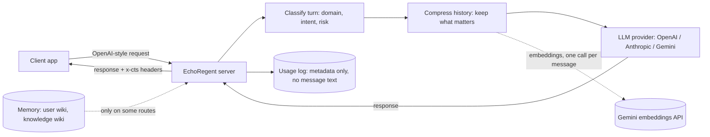

# EchoRegent — Codebase Structure & Architecture Map

A reference map for a reviewer. It shows how the system is organized, what
each part does, which model is used for what, and what is built versus not
built. It is a picture of the design, not a request to review code.

---

## 1. What it is, in one paragraph

LLMs are stateless, so an app re-sends the whole conversation on every call.
Cost and latency grow with the tokens sent, and irrelevant context can
degrade answers. EchoRegent is a **token middle layer**: it sits between an
app and an LLM provider, removes noise from the conversation history before
the call, and reports what it did and what it saved. Beyond compression it
also classifies each turn (domain, intent, risk), can inject long-term
memory, and is proposed to score the LLM's output.

---

## 2. System diagram



The same picture as plain text:

```
 Client app
    │  OpenAI-style request  (swap baseURL, nothing else changes)
    ▼
 ┌────────────────────────────── EchoRegent server ──────────────────────────────┐
 │  1 classify turn ──▶ 2 compress history ──▶ 3 forward to provider              │
 │  (domain/intent/     (select relevant        (OpenAI / Anthropic / Gemini)       │
 │   risk)               messages, add a                  │                         │
 │                       short summary of                 ▼                         │
 │                       older turns)             4 response + usage headers        │
 │                            │                                                     │
 │                   embeddings API (Gemini)                                        │
 └───────────────┬──────────────────────────────────────────────┬──────────────────┘
                 ▼                                              ▼
        Memory stores (optional)                    Usage log (metadata only)
```

---

## 3. Request flow on the primary path (`POST /v1/chat/completions`)

1. Reject unsupported shapes (tool calls, multimodal) with a clean error.
2. Authenticate the caller's EchoRegent key; apply a per-key rate limit.
3. Split the messages into system message, history, and the current user turn.
4. Classify the turn with keyword rules into a "routing frame" (domain,
   intent, conversation state, risk flags, confidences).
5. Compress the history: by embedding similarity if an embeddings key is
   available, otherwise by the rule-based scorer.
6. Build the provider-specific request and forward it.
7. Relay the response (streamed or not), adding headers: tokens saved,
   domain, intent, risk, compression mode and percentage, provider-reported
   usage.
8. Log one metadata row (domain, provider, model, token counts, compression
   mode, messages in and kept).

On this path no memory is injected and no EchoRegent system prompt is added;
the caller's own system message passes through unchanged.

---

## 4. Codebase structure

```
echoregent/
├── src/
│   ├── server.ts            HTTP server; every route lives here
│   ├── cts-core/            the product logic (no HTTP)
│   │   ├── classifier.ts    domain / intent / state / risk detection
│   │   ├── signals.ts       feature extraction for the classifier
│   │   ├── compressor.ts    the three compression modes
│   │   ├── embeddings.ts    Gemini embeddings client
│   │   ├── ml-classifier.ts ONNX wrapper: DistilBERT domain model
│   │   ├── ml-t5.ts         ONNX wrapper: T5 summarizer
│   │   ├── semantic-cache.ts MiniLM response cache
│   │   ├── wiki.ts          per-user memory (rule-based extraction)
│   │   ├── llmWiki.ts       knowledge-base memory (LLM-assisted)
│   │   ├── router.ts        builds a domain-specific system prompt
│   │   ├── tokenizer.ts     token counting for savings estimates
│   │   └── types.ts         shared vocabulary (RoutingFrame, etc.)
│   ├── saas/                API keys, usage log, quotas, rate limit
│   │                        (Postgres, or local JSON files)
│   ├── providerServer.ts    calls providers for the hosted endpoints
│   ├── admin-ui.ts          admin dashboard page
│   ├── memory-ui.ts         customer "your memory" page
│   └── main.ts, styles.css  landing-page client code and styling
├── index.html               landing / demo page
├── cts-mcp/                 separate MCP server (4 tools)
├── ml/                      model weights (not in git; git-lfs branch)
├── audit/                   tests and benchmark scripts
└── docs/                    documentation
```

---

## 5. What runs where

| Route | Classifier | Compressor | Memory injected | Response cache | LLM key from |
|---|---|---|---|---|---|
| `/v1/chat/completions` (primary) | keyword rules | embeddings, else rule-based | no | no | caller |
| `/api/chat` | DistilBERT, else keywords | T5, else rule-based | yes | no | caller (in body) or canned reply |
| `/demo/chat` | keyword rules | rule-based | yes | MiniLM | EchoRegent |
| `/demo/compress-async` | DistilBERT | T5 | no | no | none |
| `/demo/compress-embeddings` | keyword rules | embeddings | no | no | none |
| `/api/classify`, `/compress` | keyword rules | rule-based (`/compress`) | no | no | none |

The two trained models (DistilBERT, T5) are **not** on the primary path.

---

## 6. Models: what each is used for

| Model | What it is | Job | Where it runs | State |
|---|---|---|---|---|
| Keyword rules | hand-written patterns | domain, intent, state, risk | in-process | production default |
| DistilBERT | 6-layer, ~66M params, fine-tuned | domain only (7 classes, no `legal`) | local ONNX | works; biased by imbalanced training data |
| T5-small | ~60M params, fine-tuned | abstractive summary of history | local ONNX | output is broken; guarded by a fallback |
| MiniLM-L6 | ~23 MB quantized | sentence embeddings for the response cache | local ONNX | works |
| Gemini embeddings | remote API | relevance of each message to the current turn | HTTPS | works; one call per message |
| Provider LLMs | OpenAI / Anthropic / Gemini | the actual answer | HTTPS | the customer's choice |

---

## 7. Compression: how the three modes pick what to keep

All modes pass histories of 4 messages or fewer through unchanged, and
prepend a short synthetic summary of older turns built from extracted facts
(entities, constraints, open items, the user's goal).

- **Rule-based:** scores each message with domain vocabularies, overlap with
  known facts, boosts for codes/IDs and action language, and penalties for
  small talk. Keeps a recent window (larger for coding, support and sales),
  a couple of high-scoring "anchor" messages, rescues messages that hold
  hard facts (IDs, dates, numbers) the selection would drop, and always keeps
  a minimum fraction of the conversation.
- **Embeddings:** embeds the current turn and every older message, ranks by
  similarity, fills a token budget by rank, keeps the recent window, and
  applies the same minimum floor. Needs no domain label.
- **T5:** asks a small model to write a summary. Currently unusable.

The summary text is kept stable across turns so that provider-side prompt
caching is not broken.

---

## 8. Tech stack

| Layer | Technology |
|---|---|
| Server | Node.js, TypeScript, plain `node:http` |
| Local ML inference | transformers.js → onnxruntime-node |
| Remote embeddings | Gemini REST API |
| Persistence | Postgres, or local JSON files |
| Frontend | Vite, vanilla TypeScript, one CSS file |
| Tooling for training and export (planned) | Python: transformers, sentence-transformers, optimum |
| Deploy | Railway (nixpacks) or Docker |

---

## 9. Data flow: what leaves the server

- The conversation goes to the **customer's LLM provider** (expected).
- On the embeddings path, message text **also goes to Google's embeddings
  API**, even if the customer's provider is OpenAI or Anthropic.
- The usage log keeps metadata only; message text is not stored.
- Memory stores hold extracted facts per key and per end user, which the
  customer can view and delete.
- Provider keys travel per request and are not stored.

---

## 10. Latency-relevant facts

| Step | Cost |
|---|---|
| Keyword classify | about 0.1–0.2 ms |
| Rule-based compress (9 to 51 messages) | about 0.7–1.5 ms |
| Local MiniLM embedding | about 2.5 ms |
| DistilBERT classify (warm) | about 34 ms |
| Gemini embeddings path | **not measured**; 1 + N network calls per request, and the whole history is re-embedded every turn |

Compression should reduce the provider's processing time (fewer input
tokens), but the embeddings step adds time. The net effect on end-to-end
latency has not been measured.

---

## 11. Capability status

| Capability | Status |
|---|---|
| Compress history (rule-based, embeddings) | built |
| Token and cost accounting (estimated, plus provider-reported usage) | built; no holdout-verified savings yet |
| Memory (view, clear, per end-user scope) | built; extraction is rough |
| Risk signals (crisis, medical, legal, financial) | built as flags only; they do not change behavior |
| Protected zones (never compress high-risk conversations) | not built |
| Trained classifier and summarizer on the main path | not in use |
| Runtime quality check that compression did not hurt an answer | not built |
| Output scoring / governance of LLM answers | not built; proposed |
